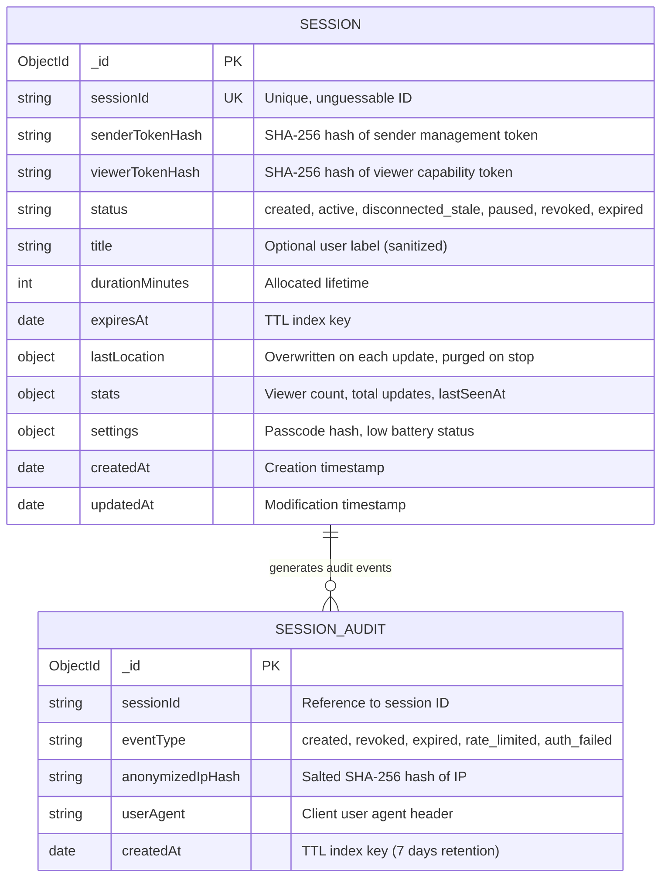

# Locato - Database Schema Specification

> **Version:** 1.0.0  
> **Status:** Specification Baseline (Phase 1 Approved)  
> **Database Engine:** MongoDB 6.0+ / MongoDB Atlas  
> **ODM:** Mongoose 8.x  
> **Core Principle:** Ephemeral State Coordination & Zero Historical Retention  

---

## 1. Data Storage Philosophy & Privacy Directives

The database architecture of Locato is strictly designed around **ephemeral state coordination**. It is fundamentally not an analytical warehouse or a tracking archive.

### 1.1 The Zero-History Principle
- **No Historical Breadcrumbs Collection:** There is **no** `coordinates`, `breadcrumbs`, or `tracking_points` collection in Locato. Under no circumstances are individual GPS points appended to an array or historical log.
- **Single Latest Position Slot:** The session document stores only the *latest reported coordinate* in an embedded subdocument (`lastLocation`). Each new coordinate update overwrites this single slot in place.
- **Immediate Purge on Revocation:** When the sender triggers the "Stop Sharing" kill switch or the session expires, the `lastLocation` field is immediately unset (`$unset: { lastLocation: 1 }`) in the database, ensuring zero persistent retention even before the document TTL cleaner sweeps the document.
- **Cryptographic Token Hashing:** High-privilege tokens (`senderToken`, `viewerToken`) are never persisted in cleartext. Only their one-way SHA-256 digests are stored.

---

## 2. Collections Overview

The Locato data model consists of two collections:

1. **`sessions` (Primary Operational Collection):** Ephemeral session state, configuration, latest coordinate snapshot, and expiration metadata.
2. **`session_audits` (Anonymized Security & Diagnostic Log):** Minimal operational telemetry recording session lifecycle events (created, revoked, rate limited, auth failure) for abuse prevention. Contains **no GPS coordinates, no cleartext tokens, and no raw IP addresses**.



---

## 3. Detailed Collection Specifications

### 3.1 The `sessions` Collection

#### 3.1.1 Schema Definition & Field Annotations

| Field | Type | Required | Default | Description | Index |
| :--- | :--- | :--- | :--- | :--- | :--- |
| `_id` | `ObjectId` | Yes | Auto | MongoDB internal document identifier | Primary |
| `sessionId` | `String` | Yes | - | Cryptographically generated public session identifier (16-24 chars base64url) | Unique Index |
| `senderTokenHash` | `String` | Yes | - | Hex-encoded SHA-256 hash of the sender secret management token | Secondary Index |
| `viewerTokenHash` | `String` | No | `null` | Hex-encoded SHA-256 hash of the viewer access capability token | Secondary Index |
| `status` | `String` | Yes | `'created'` | Enum: `'created'`, `'active'`, `'disconnected_stale'`, `'paused'`, `'revoked'`, `'expired'` | Compound Index with `expiresAt` |
| `title` | `String` | No | `null` | Sanitized optional label (max 60 characters) | None |
| `durationMinutes`| `Number` | Yes | `30` | Session lifetime in minutes (5 to 480) | None |
| `expiresAt` | `Date` | Yes | - | Exact wall-clock timestamp when session must expire | **TTL Index (`expireAfterSeconds: 0`)** |
| `lastLocation` | `Object` | No | `null` | Embedded subdocument holding latest coordinate. Purged on revocation. | None |
| `lastLocation.latitude` | `Number` | Yes (if loc exists) | - | WGS84 Latitude between -90.0 and +90.0 | None |
| `lastLocation.longitude` | `Number` | Yes (if loc exists) | - | WGS84 Longitude between -180.0 and +180.0 | None |
| `lastLocation.accuracy` | `Number` | Yes (if loc exists) | - | Horizontal accuracy radius in meters (float >= 0) | None |
| `lastLocation.heading` | `Number` | No | `null` | Direction of travel in degrees (0.0 to 360.0) | None |
| `lastLocation.speed` | `Number` | No | `null` | Ground speed in meters per second (float >= 0) | None |
| `lastLocation.altitude` | `Number` | No | `null` | Height above sea level in meters (float) | None |
| `lastLocation.timestamp` | `Date` | Yes (if loc exists) | - | Timestamp when coordinate was acquired by device | None |
| `stats.viewerCount` | `Number` | Yes | `0` | Number of currently connected viewer sockets | None |
| `stats.totalUpdates` | `Number` | Yes | `0` | Counter of location updates processed during session | None |
| `stats.lastSeenAt` | `Date` | No | `null` | Last time sender socket communicated with server | None |
| `settings.requirePasscode` | `Boolean` | Yes | `false` | Whether session is protected by a PIN | None |
| `settings.passcodeHash` | `String` | No | `null` | Argon2/Bcrypt hash of optional numeric PIN | None |
| `settings.senderBatteryLow` | `Boolean` | Yes | `false` | Flag indicating sender battery < 15% | None |
| `createdAt` | `Date` | Yes | `Date.now` | Document creation timestamp | None |
| `updatedAt` | `Date` | Yes | `Date.now` | Last document update timestamp | None |

#### 3.1.2 Indexes

```javascript
// 1. Unique index on public session identifier
sessionSchema.index({ sessionId: 1 }, { unique: true });

// 2. Token lookup index for sender authentication
sessionSchema.index({ senderTokenHash: 1 });

// 3. TTL Index for hard database-level cleanup
// MongoDB TTL monitor runs every 60s and sweeps documents where expiresAt <= now
sessionSchema.index({ expiresAt: 1 }, { expireAfterSeconds: 0 });

// 4. Compound index for fast active session status validation
sessionSchema.index({ sessionId: 1, status: 1, expiresAt: 1 });
```

---

### 3.2 The `session_audits` Collection

To identify automated abuse, DDoS attacks, or brute-force attempts on passcodes without compromising user location privacy, security telemetry is recorded in an ephemeral audit log.

#### 3.2.1 Schema Definition & Field Annotations

| Field | Type | Required | Default | Description | Index |
| :--- | :--- | :--- | :--- | :--- | :--- |
| `_id` | `ObjectId` | Yes | Auto | Internal ID | Primary |
| `sessionId` | `String` | Yes | - | Associated session ID | Secondary Index |
| `eventType` | `String` | Yes | - | Enum: `'created'`, `'started'`, `'paused'`, `'revoked'`, `'expired'`, `'auth_failed'`, `'passcode_failed'` | None |
| `anonymizedIpHash` | `String` | Yes | - | Salted SHA-256 hash of client IP (prevents raw IP storage) | None |
| `userAgent` | `String` | No | `null` | Browser user-agent header string (max 200 chars) | None |
| `createdAt` | `Date` | Yes | `Date.now` | Event timestamp | **TTL Index (`expireAfterSeconds: 604800` = 7 days)** |

---

## 4. Mongoose Model Implementation (TypeScript)

Production TypeScript implementation for the `Session` model in `apps/api/src/models/session.model.ts`:

```typescript
import { Schema, model, Document, Model } from 'mongoose';

export type SessionStatus = 'created' | 'active' | 'disconnected_stale' | 'paused' | 'revoked' | 'expired';

export interface ILocationSnapshot {
  latitude: number;
  longitude: number;
  accuracy: number;
  heading?: number | null;
  speed?: number | null;
  altitude?: number | null;
  timestamp: Date;
}

export interface ISessionDocument extends Document {
  sessionId: string;
  senderTokenHash: string;
  viewerTokenHash?: string | null;
  status: SessionStatus;
  title?: string | null;
  durationMinutes: number;
  expiresAt: Date;
  lastLocation?: ILocationSnapshot | null;
  stats: {
    viewerCount: number;
    totalUpdates: number;
    lastSeenAt?: Date | null;
  };
  settings: {
    requirePasscode: boolean;
    passcodeHash?: string | null;
    senderBatteryLow: boolean;
  };
  createdAt: Date;
  updatedAt: Date;
  isExpired(): boolean;
  isActive(): boolean;
}

const LocationSnapshotSchema = new Schema<ILocationSnapshot>(
  {
    latitude: {
      type: Number,
      required: true,
      min: -90.0,
      max: 90.0,
      set: (v: number) => Math.round(v * 1e6) / 1e6, // Truncate to 6 decimal places (~0.11m precision)
    },
    longitude: {
      type: Number,
      required: true,
      min: -180.0,
      max: 180.0,
      set: (v: number) => Math.round(v * 1e6) / 1e6,
    },
    accuracy: {
      type: Number,
      required: true,
      min: 0,
    },
    heading: {
      type: Number,
      default: null,
      min: 0,
      max: 360,
    },
    speed: {
      type: Number,
      default: null,
      min: 0,
    },
    altitude: {
      type: Number,
      default: null,
    },
    timestamp: {
      type: Date,
      required: true,
    },
  },
  { _id: false }
);

const SessionSchema = new Schema<ISessionDocument>(
  {
    sessionId: {
      type: String,
      required: true,
      unique: true,
      trim: true,
      index: true,
    },
    senderTokenHash: {
      type: String,
      required: true,
      index: true,
    },
    viewerTokenHash: {
      type: String,
      default: null,
      index: true,
    },
    status: {
      type: String,
      enum: ['created', 'active', 'disconnected_stale', 'paused', 'revoked', 'expired'],
      default: 'created',
      required: true,
    },
    title: {
      type: String,
      default: null,
      maxlength: 60,
      trim: true,
    },
    durationMinutes: {
      type: Number,
      required: true,
      min: 5,
      max: 480, // Max 8 hours
      default: 30,
    },
    expiresAt: {
      type: Date,
      required: true,
      index: { expireAfterSeconds: 0 }, // Automated MongoDB TTL purge
    },
    lastLocation: {
      type: LocationSnapshotSchema,
      default: null,
    },
    stats: {
      viewerCount: { type: Number, default: 0, min: 0 },
      totalUpdates: { type: Number, default: 0, min: 0 },
      lastSeenAt: { type: Date, default: null },
    },
    settings: {
      requirePasscode: { type: Boolean, default: false },
      passcodeHash: { type: String, default: null },
      senderBatteryLow: { type: Boolean, default: false },
    },
  },
  {
    timestamps: true,
    versionKey: false,
  }
);

// Compound index for active session querying
SessionSchema.index({ sessionId: 1, status: 1, expiresAt: 1 });

// Instance methods
SessionSchema.methods.isExpired = function (): boolean {
  return new Date() >= this.expiresAt || this.status === 'expired' || this.status === 'revoked';
};

SessionSchema.methods.isActive = function (): boolean {
  return this.status === 'active' && !this.isExpired();
};

export const Session: Model<ISessionDocument> = model<ISessionDocument>('Session', SessionSchema);
```

---

## 5. TTL Mechanics & Double-Layer Expiration Enforcement

MongoDB's native TTL index provides an asynchronous garbage collection sweep that runs approximately every **60 seconds**. In a high-security ephemeral system, an expired or revoked session must **never** be accessible during that 60-second window.

### 5.1 Layer 1: Application-Level Real-Time Guard (Immediate)
Every query, mutation, and WebSocket handshake enforces an immediate wall-clock condition:

```javascript
// Database query always requires expiresAt > now and status != 'revoked'
const activeSession = await Session.findOne({
  sessionId,
  status: { $in: ['created', 'active', 'disconnected_stale', 'paused'] },
  expiresAt: { $gt: new Date() }
});

if (!activeSession) {
  throw new AppError('SESSION_EXPIRED', 'This session has expired or been revoked.', 410);
}
```

If `expiresAt <= new Date()`, the application transitions `status = 'expired'`, unsets `lastLocation`, and broadcasts `session:expired` to connected sockets.

### 5.2 Layer 2: MongoDB Background TTL Monitor (Hard Garbage Collection)
- The TTL index `{ expiresAt: 1 }, { expireAfterSeconds: 0 }` instructs the WiredTiger storage engine to permanently evict the document from disk and memory once `expiresAt` is reached.
- This ensures that physical data deletion is guaranteed even in catastrophic process failure scenarios.

---

## 6. Location Coordinate Truncation & Geodetic Precision

Coordinates are strictly truncated to **6 decimal places**:

$$\text{Precision at 6 decimal places} \approx 0.111 \text{ meters} \ (11.1 \text{ cm})$$

```javascript
const roundedLatitude = Math.round(rawLat * 1e6) / 1e6;
const roundedLongitude = Math.round(rawLng * 1e6) / 1e6;
```

This guarantees sub-meter resolution while eliminating sub-millimeter noise that wastes bandwidth and creates device fingerprinting vectors.
