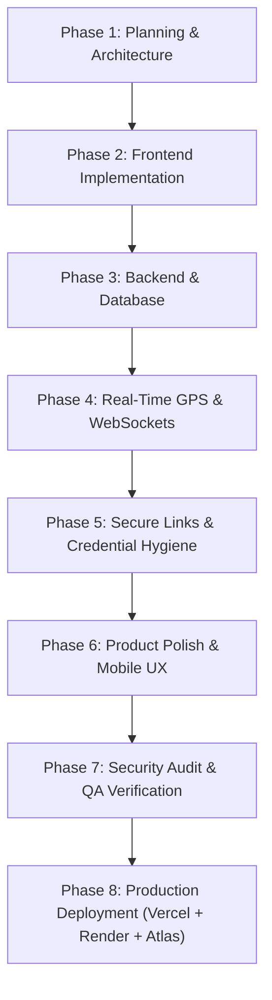

# Locato - Eight-Phase Development Roadmap

> **Version:** 1.0.0  
> **Status:** Roadmap Baseline (Phase 1 Approved)  
> **Target Delivery Model:** Sequential Eight-Phase Delivery Lifecycle  

---

## 1. Phased Implementation Strategy

The development of Locato is structured into eight sequential phases. Each phase has explicit objectives, verifiable acceptance criteria, and security/privacy reviews.

---

## 2. Phase-by-Phase Breakdown & Acceptance Criteria

### Phase 1: Planning and Architecture
**Objective:** Inspect the repository and establish a documented, secure architecture for Locato before implementing the full application.
- **Tasks:**
  - Initialize Git repository and `.gitignore`.
  - Propose clean monorepo folder structure (`apps/web`, `apps/api`, `docs/`).
  - Specify database models, single-coordinate snapshot, and MongoDB TTL mechanics.
  - Define REST and Socket.IO API contracts with Zod validation schemas.
  - Formulate separate sender and recipient authorization models.
  - Document browser geolocation constraints, mobile WebKit sleep, Screen Wake Lock, and HTTPS rules.
  - Create and maintain `docs/MASTER_ROADMAP.md`.
- **Acceptance Criteria:**
  - Repository state is documented.
  - Architecture and folder structure are specified.
  - Database/session model is documented.
  - API and real-time contracts are documented.
  - Security/privacy requirements are documented.
  - Eight-phase roadmap exists.
  - No unnecessary full implementation has started.

---

### Phase 2: Frontend
**Objective:** Build the complete React client application with typed components, responsive layouts, and isolated development mocks.
- **Tasks:**
  - Initialize `apps/web` with Vite, React 18+, TypeScript, Tailwind CSS, and shadcn/ui.
  - Install and configure Leaflet, React-Leaflet, and Lucide React.
  - Build Landing page (`HomePage.tsx`) with product explanation and feature highlights.
  - Build Create Session flow (`CreatePage.tsx`) with duration selector, optional PIN, and consent pre-prompt.
  - Build Sender Control View (`SenderPage.tsx`) with live broadcast badge, viewer count, GPS metrics, and Kill Switch.
  - Build Recipient Tracking View (`TrackPage.tsx`) with interactive Leaflet map, smooth marker, and connection indicators.
  - Build state views: loading, empty, permission-denied, disconnected, expired, and revoked.
  - Strictly isolate mock data from production paths.
  - Run TypeScript type checks, linting, and production Vite build.
- **Acceptance Criteria:**
  - All views render responsively on desktop and mobile viewports.
  - Leaflet map loads OpenStreetMap tiles with attribution.
  - TypeScript compilation and Vite build pass with zero errors.

---

### Phase 3: Backend and Database
**Objective:** Implement the Express REST API, MongoDB connection, Mongoose model, Zod validation, token hashing, and error handling.
- **Tasks:**
  - Initialize `apps/api` with TypeScript, Express, and Morgan/Pino.
  - Connect to MongoDB Atlas with retry logic and graceful shutdown.
  - Implement `Session` Mongoose schema with `sessionId` unique index and `expiresAt` TTL index.
  - Implement SHA-256 token hashing in `crypto.service.ts`.
  - Implement REST endpoints:
    - `POST /api/v1/sessions` (Create session, returns `senderToken`, `viewerToken`, `shareUrl`).
    - `GET /api/v1/sessions/:id` (Fetch metadata; omit location if passcode locked).
    - `POST /api/v1/sessions/:id/verify-passcode` (Unlock session).
    - `POST /api/v1/sessions/:id/stop` (Sender kill switch, unsets `lastLocation`).
    - `POST /api/v1/sessions/:id/pause` and `POST /resume`.
    - `PATCH /api/v1/sessions/:id/extend`.
    - `GET /api/v1/health` (Healthcheck).
  - Enforce expiry dynamically on every request (HTTP 410).
  - Add automated tests for authorization, expiry, revocation, validation, rate limiting, and database errors.
- **Acceptance Criteria:**
  - All REST endpoints pass automated integration tests.
  - Revocation immediately wipes `lastLocation` in MongoDB.
  - Raw secret tokens are never stored in cleartext.

---

### Phase 4: Real-Time GPS
**Objective:** Connect frontend and backend via authenticated Socket.IO for live coordinate streaming with zero recipient tracking.
- **Tasks:**
  - Attach Socket.IO to Express server with CORS and room multiplexing (`session:${sessionId}`).
  - Implement handshake authentication verifying `senderTokenHash` and `viewerTokenHash`.
  - Implement `useGeolocation` hook wrapping `navigator.geolocation.watchPosition` with consent gating.
  - Implement adaptive GPS throttling (15s stationary, 4-5s walking, 2-3s vehicle).
  - Unidirectional broadcasting: viewers cannot emit coordinates.
  - Implement Disconnect Grace Period: 60-second timer when sender cellular link drops.
  - Implement real-time Kill Switch: `sender:terminate` invalidates session, disconnects sockets, and purges database coordinates.
  - Test with two browser windows simultaneously.
- **Acceptance Criteria:**
  - Sender location updates broadcast to recipient map in <250ms.
  - Recipient location is never requested or transmitted.
  - Kill switch terminates viewer socket connection within 500ms.

---

### Phase 5: Secure Links
**Objective:** Harden session URLs, credential handling, address bar hygiene, and recipient authorization.
- **Tasks:**
  - Generate unpredictable 128-bit NanoID session IDs and 256-bit sender tokens.
  - Implement URL Hash Fragment capability architecture (`https://locato.app/v/:id#key=<token>`).
  - Implement client-side secret stripping: extract key from hash and invoke `window.history.replaceState` to scrub the address bar.
  - Support one-click copy, native Web Share API (`navigator.share`), and QR code modal.
  - Enforce server-side expiration checks; client countdown is purely informational.
  - Write tests for invalid, expired, revoked, and reused credentials, and unauthorized socket joins.
- **Acceptance Criteria:**
  - Secret key does not linger in the browser address bar.
  - Unauthorized socket joins are rejected with descriptive errors.
  - Expired links return clean user-facing rejection cards.

---

### Phase 6: Product Polish
**Objective:** Enhance mobile UX, visual indicators, map interactions, and battery/network resilience.
- **Tasks:**
  - Session countdown timer with visual color shift (green -> amber -> red).
  - Connection quality indicator (online, reconnecting, offline).
  - Stale-location warning if sender updates lapse for >30 seconds.
  - Recenter map button and dynamic accuracy radius circle (`L.circle`).
  - Animated live marker glides between coordinates using linear interpolation.
  - Stop-sharing confirmation modal to prevent accidental cancellation.
  - Screen Wake Lock toggle to prevent mobile display sleep.
  - Honest PWA configuration (documenting that PWAs do not guarantee background GPS execution).
- **Acceptance Criteria:**
  - Touch interactions smooth on mobile viewports.
  - Marker glides smoothly without jumping or flickering.
  - Wake Lock maintains screen power on supported mobile browsers.

---

### Phase 7: Security and QA
**Objective:** Conduct comprehensive security audit, privacy review, resilience testing, and documentation.
- **Tasks:**
  - Audit code for secret leakage, coordinate logging, and injection vectors.
  - Run automated test suite across unit, integration, and socket handlers.
  - Test network failure modes: rapid reconnect, airplane mode toggle, server restart.
  - Verify Helmet headers, CSP, and `Referrer-Policy: no-referrer`.
  - Create documentation:
    - `docs/SECURITY_AUDIT.md`
    - `docs/TEST_REPORT.md`
    - `docs/PRIVACY_REVIEW.md`
    - `docs/KNOWN_LIMITATIONS.md`
    - `docs/PRODUCTION_READINESS.md`
  - Fix any critical or high-severity issues identified.
- **Acceptance Criteria:**
  - Zero high or critical vulnerabilities in audit.
  - Zero GPS coordinates or raw tokens discovered in application logs.
  - All 5 QA and security documents completed.

---

### Phase 8: Deployment
**Objective:** Deploy Locato to production infrastructure with verified HTTPS and real-time connectivity.
- **Tasks:**
  - Deploy frontend SPA to Vercel with automated preview builds.
  - Deploy backend API & Socket.IO server to Render with persistent WebSockets.
  - Configure production MongoDB Atlas replica set with IP access rules.
  - Configure CORS, HTTPS, and environment variables (no secrets in client bundles).
  - Author comprehensive deployment guide in `docs/DEPLOYMENT.md`.
  - Conduct live two-device real-world verification.
- **Acceptance Criteria:**
  - Live production URLs active on HTTPS.
  - Health checks returning 200 OK.
  - Dual-device live tracking verified in production.

---

## 3. Production Definition of Done (DoD)

A release candidate is deemed production-ready only when:
1. **Zero History Guarantee:** No coordinate history logs exist in MongoDB, disk logs, or error trackers.
2. **Consent Pre-Prompt:** Geolocation permissions are requested strictly following user interaction with the explanatory pre-prompt.
3. **Security Standards:** Clean audit from `npm audit`, Helmet security headers verified, and no plaintext tokens stored in MongoDB.
4. **Kill Switch Latency:** Triggering "Stop Sharing" wipes backend coordinates and closes viewer sockets within **500 milliseconds**.
5. **Cross-Platform Verification:** Verified on iOS Safari (iOS 16+), Chrome for Android, desktop Chrome, Firefox, and Safari.
6. **Automated Test Coverage:** >80% unit test coverage on core session services and 100% passing E2E test suite.
