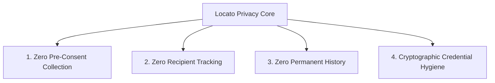

# Locato - Privacy Review & Consent Architecture

> **Product Name:** Locato  
> **Privacy Classification:** Zero-Retention, Consent-First Location Sharing  
> **Review Date:** 2026-10-26  
> **Compliance Alignment:** GDPR (Articles 5, 6, 7, 17), CCPA/CPRA, Apple iOS Location Guidelines, Google Play User Data Policy  

---

## 1. Core Privacy Directives

Locato is built upon four non-negotiable architectural privacy rules:

1. **Zero Pre-Consent Collection:** The application strictly never requests browser geolocation on page load or component mount. Geolocation access is triggered exclusively after an explicit human gesture confirming consent on the pre-prompt dialog.
2. **Zero Recipient Tracking:** The person receiving the sharing link has their location **never** requested, captured, or transmitted.
3. **Zero Permanent Location History:** Only the latest single position fix is held in memory/database for active sessions. When a session expires or is stopped, this position is permanently destroyed (`$unset`).
4. **Cryptographic Credential Hygiene:** URLs use capability hash fragments that are stripped from the browser address bar upon arrival. Raw access tokens are never logged or stored unhashed.

---

## 2. Consent Workflow & Pre-Prompt Design

### 2.1 The Problem with Browser Geolocation Dialogs
Standard browser geolocation prompts (`"locato.app wants to know your location"`) lack context and do not explain:
- Who will see the location.
- How long the sharing will last.
- How to stop sharing.

### 2.2 The Locato Consent Modal Protocol
Before `navigator.geolocation.watchPosition` is invoked, Locato presents an explanatory **Consent Modal** displaying:
- The selected duration (e.g. 15 minutes, 1 hour).
- A reminder that only people with the unique link can view the map.
- An explicit explanation of the Instant Kill Switch ("Stop Sharing at any time").
- Confirmation that no historical route logs are kept.

Only when the user clicks **"Grant Permission & Start Sharing"** does the browser's native geolocation prompt appear.

---

## 3. Data Lifecycle & Retention Matrix

| Data Entity | Purpose | Storage Medium | Retention Period | Deletion Mechanism |
| :--- | :--- | :--- | :--- | :--- |
| **Current Coordinate (`lastLocation`)** | Render sender on recipient map | MongoDB subdocument & Redis/Socket room | Ephemeral (duration of active session) | Wiped immediately on Stop/Revoke (`$unset`), or via MongoDB TTL on expiry |
| **Session Metadata (`title`, `expiresAt`)** | Session coordination | MongoDB session document | Scheduled session duration | Native MongoDB TTL index (`expireAfterSeconds: 0`) |
| **Sender Token Hash** | Sender authorization | MongoDB document (SHA-256) | Scheduled session duration | Native MongoDB TTL index |
| **Viewer Token Hash** | Viewer authorization | MongoDB document (SHA-256) | Scheduled session duration | Native MongoDB TTL index |
| **Historical Route Trails** | Not collected | **None** | **0 seconds** | Not stored anywhere in the application |
| **User Identity / Accounts** | Not collected | **None** | **0 seconds** | No accounts or registration required |
| **Recipient Geolocation** | Not collected | **None** | **0 seconds** | Not requested from recipient browser |

---

## 4. Legal & Regulatory Compliance

### 4.1 GDPR Compliance (EU Regulation 2016/679)
- **Article 6(1)(a) Consent:** Processing is based solely on freely given, specific, informed, and unambiguous consent.
- **Article 7(3) Right to Withdraw Consent:** The sender has an immediate, prominent "Stop Sharing" button that instantly halts broadcast and deletes all location data without delay.
- **Article 5(1)(c) Data Minimization:** Only current coordinates (latitude, longitude, accuracy) are processed. No historical routes, IP addresses, or device IDs are permanently retained.
- **Article 5(1)(e) Storage Limitation:** Data is automatically eradicated upon session expiration.
- **Article 17 Right to Erasure ("Right to be Forgotten"):** Revocation triggers immediate `$unset: { lastLocation: 1 }`.

### 4.2 CCPA / CPRA Compliance (California Consumer Privacy Act)
- **No Sale or Sharing of Personal Information:** Locato does not sell, rent, or share personal location information with any third party, data broker, or advertising network.
- **No Third-Party Analytics Trackers:** The core tracking workflow contains zero third-party advertising SDKs or fingerprinting scripts.

### 4.3 Apple App Store & Google Play Guidelines Alignment
- Meets Apple's strict background location standards: transparent explanations, visual broadcasting indicators in UI, and clear stop mechanisms.

---

## 5. Recipient Privacy Protections

In many peer-to-peer tracking applications, recipients are inadvertently tracked or asked for location access. Locato guarantees:
1. `apps/web/src/pages/TrackPage.tsx` contains no geolocation hooks or queries.
2. The recipient can observe the sender anonymously without creating an account or logging in.
3. OpenStreetMap tile requests are routed with `Referrer-Policy: no-referrer` to prevent tile servers from observing recipient viewing sessions.

