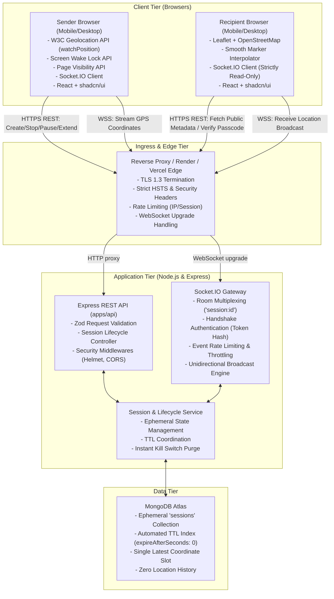
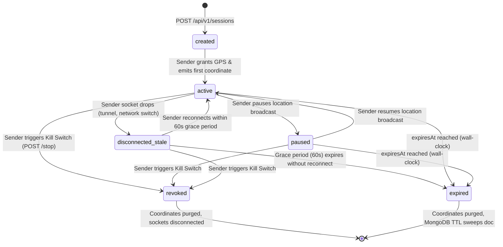
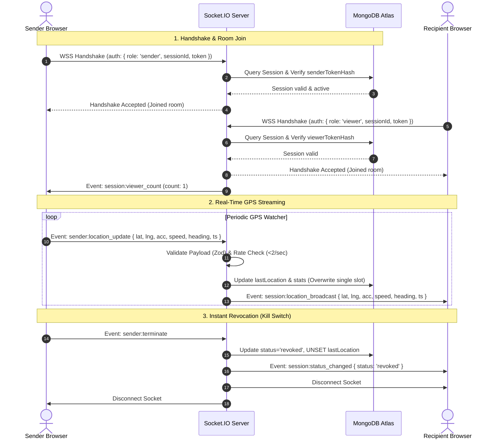

# Locato - Technical Architecture Specification

> **Version:** 1.0.0  
> **Status:** Architecture Baseline (Phase 1 Approved)  
> **System Name:** Locato Real-Time Location Platform  

---

## 1. System Architecture Overview

Locato is architected as an ephemeral, real-time distributed web platform organized into a modern decoupled workspace:
- **Frontend SPA (`apps/web`):** React 18+, TypeScript, Vite, Tailwind CSS, shadcn/ui, React Router, and Leaflet mapping engine.
- **Backend Gateway (`apps/api`):** Node.js (LTS), Express REST API, and Socket.IO real-time WebSocket server.
- **Database (`MongoDB Atlas`):** Ephemeral session state, single-coordinate snapshot, and automated TTL garbage collection.
- **Edge & Hosting:** Vercel (Frontend), Render (Backend), Cloudflare / Let's Encrypt (TLS 1.3 termination and edge rate limiting).

### 1.1 Architecture Diagram



---

## 2. Workspace & Folder Structure

Locato adopts a standardized monorepo structure separating frontend client and backend service:

```text
locato/
├── apps/
│   ├── web/                     # Frontend Client Application
│   │   ├── public/              # Static assets (favicons, PWA icons)
│   │   ├── src/
│   │   │   ├── assets/          # SVG markers, map pins, audio alert
│   │   │   ├── components/      # Modular UI components
│   │   │   │   ├── common/      # Header, Footer, ErrorBoundary, ThemeToggle
│   │   │   │   ├── map/         # LeafletMap, LiveMarker, AccuracyCircle, MapControls
│   │   │   │   ├── sender/      # ConsentDialog, LiveBroadcastBar, KillSwitch, ShareModal
│   │   │   │   ├── ui/          # shadcn/ui primitives (Radix UI)
│   │   │   │   └── viewer/      # ViewerStatusCard, ReconnectNotice, ExpiredView
│   │   │   ├── hooks/           # Custom React hooks
│   │   │   │   ├── useGeolocation.ts  # W3C Geolocation watcher + adaptive throttle
│   │   │   │   ├── useWakeLock.ts     # Screen Wake Lock API wrapper
│   │   │   │   ├── useSocket.ts       # Socket.IO connection & event multiplexer
│   │   │   │   └── useSession.ts      # Sender/Viewer session lifecycle state
│   │   │   ├── lib/             # Utility helpers
│   │   │   │   ├── apiClient.ts       # Typed REST API client
│   │   │   │   ├── geoMath.ts         # Haversine distance, speed, coordinate smoothing
│   │   │   │   ├── socketClient.ts    # Socket.IO client singleton
│   │   │   │   └── utils.ts           # Class merge (clsx / tailwind-merge)
│   │   │   ├── pages/           # Route views
│   │   │   │   ├── HomePage.tsx       # Landing & marketing overview
│   │   │   │   ├── CreatePage.tsx     # Session configuration & consent pre-prompt
│   │   │   │   ├── SenderPage.tsx     # Broadcaster dashboard & kill switch
│   │   │   │   ├── TrackPage.tsx      # Recipient live map tracking view
│   │   │   │   └── NotFoundPage.tsx   # 404 / Invalid URL state
│   │   │   ├── services/        # Service abstraction layer
│   │   │   ├── types/           # Shared TypeScript types & schemas
│   │   │   ├── App.tsx          # React Router router & context providers
│   │   │   ├── index.css        # Tailwind CSS and Leaflet styles
│   │   │   └── main.tsx         # DOM mount entrypoint
│   │   ├── index.html
│   │   ├── package.json
│   │   ├── tailwind.config.js
│   │   ├── tsconfig.json
│   │   └── vite.config.ts
│   │
│   └── api/                     # Backend API & WebSocket Service
│       ├── src/
│       │   ├── config/          # Environment loader, database connection, constants
│       │   │   ├── database.ts
│       │   │   ├── environment.ts
│       │   │   └── security.ts
│       │   ├── controllers/     # Express route handlers
│       │   │   ├── health.controller.ts
│       │   │   └── session.controller.ts
│       │   ├── middleware/      # Middlewares
│       │   │   ├── auth.middleware.ts
│       │   │   ├── error.middleware.ts
│       │   │   ├── rateLimiter.middleware.ts
│       │   │   └── validate.middleware.ts
│       │   ├── models/          # Mongoose schema definitions
│       │   │   └── session.model.ts
│       │   ├── routes/          # Express route definitions
│       │   │   ├── api.router.ts
│       │   │   └── session.router.ts
│       │   ├── schemas/         # Zod validation schemas
│       │   │   ├── location.schema.ts
│       │   │   └── session.schema.ts
│       │   ├── services/        # Domain business logic
│       │   │   ├── crypto.service.ts
│       │   │   └── session.service.ts
│       │   ├── sockets/         # WebSocket handlers and room multiplexing
│       │   │   ├── handlers/
│       │   │   │   ├── location.handler.ts
│       │   │   │   └── session.handler.ts
│       │   │   ├── middleware/
│       │   │   │   └── socketAuth.middleware.ts
│       │   │   └── socketServer.ts
│       │   ├── utils/           # Structured Pino logger with redaction
│       │   │   └── logger.ts
│       │   ├── app.ts           # Express app initialization
│       │   └── server.ts        # Node.js HTTP/WebSocket server entrypoint
│       ├── tests/
│       │   ├── unit/
│       │   └── integration/
│       ├── .env.example
│       ├── package.json
│       └── tsconfig.json
├── docs/                        # Specifications and roadmaps
├── .gitignore
├── package.json                 # Monorepo root workspaces
└── README.md
```

---

## 3. Sender vs. Recipient Authorization Architecture

Locato strictly segregates sender authority from recipient observability. A user possessing the tracking link cannot masquerade as the broadcaster or manipulate session parameters.

```mermaid
flowchart LR
    subgraph SenderAuth["Sender Authorization Model"]
        S1["Sender Client"] -->|Possesses unhashed senderToken| S2["POST /sessions/:id/stop\nPOST /sessions/:id/pause\nPATCH /sessions/:id/extend"]
        S1 -->|Socket Auth: { role: 'sender', senderToken }| S3["Socket.IO Room Join"]
        S3 -->|Permitted to Emit| S4["sender:location_update\nsender:pause\nsender:terminate"]
    end

    subgraph RecipientAuth["Recipient Authorization Model"]
        R1["Recipient Client"] -->|Possesses viewerToken (via URL Hash)| R2["GET /sessions/:id\nPOST /sessions/:id/verify-passcode"]
        R1 -->|Socket Auth: { role: 'viewer', viewerToken }| R3["Socket.IO Room Join"]
        R3 -->|STRICTLY READ-ONLY| R4["Listens to session:location_broadcast\nListens to session:status_changed\nCannot emit coordinates"]
    end
```

### 3.1 Sender Authorization
- **Token Type:** High-privilege 256-bit secret token (`senderToken`) generated by Node.js `crypto.randomBytes(32)`.
- **Transmission:** Returned **only once** in the JSON response of `POST /api/v1/sessions`.
- **Client Storage:** Stored in the sender browser's `sessionStorage` or local memory. Never encoded in shareable links.
- **Server Verification:** The server stores only `SHA-256(senderToken)`. Inbound REST calls must present `Authorization: Bearer <senderToken>`, which is hashed and matched against `senderTokenHash`.
- **Permitted Actions:**
  - Push real-time coordinate updates (`sender:location_update`).
  - Pause broadcast (`POST /pause` or `sender:pause`).
  - Resume broadcast (`POST /resume` or `sender:resume`).
  - Extend session expiration (`PATCH /extend`).
  - Revoke/kill session immediately (`POST /stop` or `sender:terminate`).

### 3.2 Recipient Authorization
- **Token Type:** Read-only capability token (`viewerToken`) generated by `crypto.randomBytes(16)`.
- **Transmission:** Encoded exclusively in the URL **hash fragment** (e.g., `https://locato.app/v/xK9_m2Q8#key=vt_3d5f7...`).
- **Client Storage:** Extracted client-side via `window.location.hash` and cached in memory.
- **Server Verification:** Hashed with SHA-256 and matched against `viewerTokenHash`. If the session is passcode-protected, the recipient must also supply a verified numeric PIN.
- **Permitted Actions:**
  - View session metadata and current coordinate snapshot (`GET /api/v1/sessions/:id`).
  - Receive real-time location broadcasts over WebSocket.
  - **Zero Control:** If a viewer socket attempts to emit `sender:location_update`, the server immediately drops the packet and terminates the connection.

---

## 4. Public Session Identifier vs. Secret Access Credentials

| Dimension | Public Session ID (`sessionId`) | Sender Secret Token (`senderToken`) | Viewer Access Capability (`viewerToken`) |
| :--- | :--- | :--- | :--- |
| **Purpose** | Public session entity address & routing key | High-privilege management & transmission key | Read-only capability authorization key |
| **Possessed By** | Sender, Viewers, Backend, Log tags | **Sender ONLY** | Authorized Viewers & Sender |
| **Entropy** | 128-bit random NanoID (16-24 chars base64url) | 256-bit cryptographically secure (`crypto.randomBytes(32)`) | 128-bit cryptographically secure (`crypto.randomBytes(16)`) |
| **Storage on Server** | Plaintext in MongoDB `sessionId` (indexed) | **NEVER plaintext**. Stored as SHA-256 hash | Stored as SHA-256 hash (`viewerTokenHash`) |
| **Storage on Client** | URL path (`/v/:sessionId`) and memory | In sender `sessionStorage` or memory; never in URL | In URL **hash fragment** (`#key=...`) or memory |
| **Exposure In Logs** | Safe to log for operational correlation | **STRICTLY FORBIDDEN** from server logs | Forbidden from access logs via hash fragment design |

---

## 5. Temporary Session Lifecycle State Machine

Locato enforces a strict deterministic state machine across the lifecycle of every sharing session:



### State Definitions
1. **`created`:** Session record initialized in MongoDB. Expiration clock starts. Awaiting sender's initial coordinate transmission.
2. **`active`:** Sender is connected via WebSocket and streaming valid GPS fixes. Viewers receive live coordinates.
3. **`disconnected_stale`:** Sender socket disconnected unexpectedly (cellular drop, screen lock). A **60-second grace timer** begins. Viewers receive a "Sender signal lost - reconnecting..." amber badge, and the last marker is flagged as stale.
4. **`paused`:** Sender deliberately pressed "Pause". Session remains alive, but no coordinates are broadcast.
5. **`expired`:** Session wall-clock duration has elapsed (`new Date() >= expiresAt`). Server denies all incoming updates, purges `lastLocation`, and broadcasts `session:expired` to viewers.
6. **`revoked`:** Sender clicked "Stop Sharing" (Kill Switch). The backend immediately executes `$unset: { lastLocation: 1 }`, transitions `status = 'revoked'`, and disconnects all room sockets.

---

## 6. Real-Time Communication Architecture (Socket.IO)

### 6.1 Handshake, Streaming & Revocation Lifecycle



### 6.2 Room Multiplexing
Each sharing session maps to an isolated room: `session:${sessionId}`.
- Senders join the room upon successful handshake with `role: 'sender'` and valid `senderToken`.
- Viewers join the room upon handshake with `role: 'viewer'` and valid `viewerToken`.
- Coordinate updates emitted by the sender are broadcast solely to room viewers via `session:location_broadcast`.

### 6.3 Disconnect Grace Period
Mobile users in transit frequently encounter cell tower handovers or subway tunnels:
- When a sender socket disconnects, the server does **not** instantly terminate the session.
- A **60-second Grace Timer** starts. Viewers receive `session:sender_disconnected` `{ gracePeriodSeconds: 60 }`.
- If the sender reconnects within 60 seconds with their `senderToken`, the server attaches the socket back to the session, clears the grace timer, and emits `session:sender_reconnected`.
- If the timer elapses without reconnection, the session transitions to `expired`.

---

## 7. Technical Limitations & Device Constraints

### 7.1 Browser Background-Location Restrictions

| Platform | Background Behavior | Technical Mitigation |
| :--- | :--- | :--- |
| **iOS Safari (WebKit)** | Suspends JavaScript execution and halts `watchPosition()` within 15–30 seconds when the screen locks or the tab is minimized. | 1. **Screen Wake Lock API:** `navigator.wakeLock.request('screen')` keeps display awake while active.<br>2. **Page Visibility API:** Listens to `visibilitychange` to detect backgrounding and warn user on return.<br>3. **Audio Keep-Alive (Opt-in):** Low-volume silent audio stream maintains WebKit media execution thread. |
| **Android Chrome** | Timer resolution throttled to 1 update/minute; background geolocation suspended if screen is locked. | 1. Screen Wake Lock API.<br>2. PWA installation prompt (WebAPKs enjoy higher execution priority). |
| **Desktop Browsers** | Chrome/Edge/Firefox throttle background tabs heavily if inactive for >5 minutes. | Screen Wake Lock API + proactive tab warning banner. |

### 7.2 Mobile Battery Consumption
- Hardware GPS chip queries (`enableHighAccuracy: true`) consume 8–15% battery per hour.
- **Adaptive Sampling Algorithm:**
  - **Stationary (`speed < 0.5 m/s` or delta < 5m):** Transmit once every 15–20 seconds.
  - **Walking / Running (`speed 0.5 – 5 m/s`):** Transmit once every 4–5 seconds.
  - **Vehicular Transit (`speed > 5 m/s`):** Transmit once every 2–3 seconds.
  - Senders can toggle **Battery Saver Mode**, which disables `enableHighAccuracy` and falls back to Wi-Fi/Cellular positioning (~30-50m accuracy).

### 7.3 GPS Accuracy & Multipath Drift
- Urban canyons and indoor environments degrade GPS accuracy (horizontal radius > 100m).
- **Mitigations:**
  - UI renders an accuracy circle (`L.circle`) matching the reported radius in meters.
  - Coordinates with accuracy > 200m are visually flagged as "Low Accuracy".
  - Linear coordinate interpolation prevents the viewer's marker from jumping erratically.

### 7.4 HTTPS & Secure Context Requirements
- W3C Geolocation API, Web Cryptography API (`crypto.subtle`), and Screen Wake Lock API **strictly mandate a Secure Context (`https://` or `localhost`)**.
- In unencrypted HTTP environments, `navigator.geolocation` is `undefined` or rejects immediately.
- Production deployment mandates TLS 1.3 with automated SSL certificates (Vercel/Render/Cloudflare) and `Strict-Transport-Security` headers.

---

## 8. Deployment Architecture

```mermaid
flowchart LR
    subgraph Users["End Users"]
        Sender["Sender (Mobile/Desktop)"]
        Viewer["Recipient (Mobile/Desktop)"]
    end

    subgraph Edge["Vercel Edge Network"]
        VercelFrontend["Vercel Frontend Host\n- React SPA (apps/web)\n- Static Asset CDN\n- Automatic HTTPS"]
    end

    subgraph BackendHost["Render Cloud Platform"]
        RenderBackend["Render Web Service\n- Node.js + Express (apps/api)\n- Socket.IO Real-Time Gateway\n- Strict CORS & Security Headers"]
    end

    subgraph Database["MongoDB Atlas"]
        MongoCluster["Atlas Replica Set (M0 / M10+)\n- Automated TTL Monitor\n- Encrypted at Rest (AES-256)\n- Strict IP Access Whitelist"]
    end

    Sender -->|HTTPS (HTML/JS)| VercelFrontend
    Viewer -->|HTTPS (HTML/JS)| VercelFrontend

    Sender -->|REST API / HTTPS| RenderBackend
    Sender -->|WebSockets / WSS| RenderBackend
    Viewer -->|REST API / HTTPS| RenderBackend
    Viewer -->|WebSockets / WSS| RenderBackend

    RenderBackend <-->|Mongoose Driver| MongoCluster
```

### 8.1 Deployment Targets
- **Frontend SPA (`apps/web`):** Hosted on **Vercel** with automatic preview deployments on PRs and edge caching for static assets.
- **Backend API & WebSockets (`apps/api`):** Hosted on **Render** (Node.js Web Service) supporting native persistent WebSocket connections and automatic SSL certificate generation.
- **Database:** Hosted on **MongoDB Atlas** with automated TTL indexing and encrypted storage.
